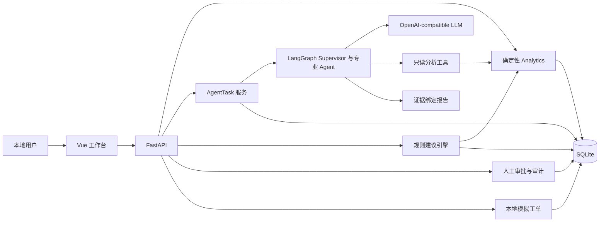

# 跨境电商 AI 经营决策 Agent 平台

最新交付状态见 [最终交付报告](docs/FINAL_DELIVERY_REPORT.md) 和 [用户人工验收补充](docs/FINAL_DEMO_ACCEPTANCE.md)。此前自动化后端166、前端3及类型检查/构建通过；用户反馈桌面分析、图表筛选、Console、任务刷新恢复、建议审批模拟通过，本轮未独立复测。达到本地可信演示标准，未达到生产发布标准；Baseline仍有安全漏拒，Candidate尚未发布。

面向 Amazon 美国站模拟经营场景的本地演示项目：把多店铺利润、广告和库存数据，连接到可追溯的 AI 分析、结构化建议、人工审批及本地模拟工单。

核心设计是**确定性工具计算数值，LLM 识别意图并选择证据，程序校验报告引用**。帮助演示“发现问题—解释依据—人工审核—追踪结果”的完整链路，不把模型自由文本当成财务事实。

> 当前仅适合本地可信演示，无真实用户认证、店铺授权或 Amazon API 集成。批准不代表执行；模拟完成不代表经营效果改善。Docker 配置已校验，但镜像构建被网络阻断，尚未完成容器部署验收。

## 功能与技术

| 能力 | 实现 |
|---|---|
| 多店铺经营分析 | 按店铺、SKU、日期查询贡献利润、广告效率、库存风险；历史成本匹配、Decimal 计算、null 原因 |
| 多 Agent 分析 | LangGraph Supervisor 顺序调度 Profit / Advertising / Inventory Agent；OpenAI-compatible ChatOpenAI 适配 |
| 报告证据 | 受控中文报告、工具证据 ID、原值绑定与最终校验，避免 LLM 重新编造数字 |
| 任务与建议 | AgentTask 持久化、轮询、刷新恢复；基于规则复算生成五类 DecisionProposal |
| 人工审批 | 固定本地演示身份、二次确认、状态机、同事务审计、并发保护 |
| 本地模拟 | 仅 approved 建议生成模拟工单；输入/审批快照、唯一约束、历史追踪，无外部经营动作 |

技术栈：Vue 3 / TypeScript / Vite / Element Plus / Axios / Vue Router / ECharts；FastAPI / SQLAlchemy 2.x / Pydantic / SQLite / Pytest；LangGraph / LangChain Core / ChatOpenAI。Python 目标 3.11，本机实际测试使用 3.13.9；Node.js 24。

## 系统架构



这些是同一后端中的模块，不是独立微服务。详细图见 [系统架构](docs/architecture.md)。

## 实际页面

截图来自运行中的本地项目，经营数据全部为模拟数据。Agent 报告为已保存的 DeepSeek 真实联调结果；拍摄截图时未再次调用模型。审批使用本地演示身份，模拟没有改变经营数据。

经营总览（材料暂缓公开，未随Git交付）

| 页面 | 截图 |
|---|---|
| 利润分析：DEMO-001 负贡献利润 | 查看（材料暂缓公开，未随Git交付） |
| 广告分析：DEMO-002 高 ACOS | 查看（材料暂缓公开，未随Git交付） |
| 库存风险：DEMO-003 断货 | 查看（材料暂缓公开，未随Git交付） |
| AI 任务报告与证据 | 查看（材料暂缓公开，未随Git交付） |
| 决策审批、审计与本地模拟 | 查看（材料暂缓公开，未随Git交付） |

截图来源与说明见 截图清单（材料暂缓公开，未随Git交付）。

## 本地快速开始

在仓库根目录使用 Windows PowerShell。需已安装目标 Python 和 Node.js 24；不要求激活虚拟环境。

```powershell
py -3.11 -m venv .venv
.\.venv\Scripts\python.exe -m pip install -r backend/requirements.txt
if (-not (Test-Path backend/.env)) { Copy-Item backend/.env.example backend/.env }
# 只在目标文件不存在时生成演示数据，不覆盖已有数据库
if (-not (Test-Path backend/demo.db)) { .\.venv\Scripts\python.exe backend/scripts/seed_demo_data.py }
$env:PYTHONPATH = (Resolve-Path backend).Path
$env:DATABASE_URL = 'sqlite:///' + ((Resolve-Path backend/demo.db).Path -replace '\','/')
.\.venv\Scripts\python.exe -m app.db.migrate_agent_tasks
.\.venv\Scripts\python.exe -m app.db.migrate_decisions
.\.venv\Scripts\python.exe -m app.db.migrate_decision_approvals
.\.venv\Scripts\python.exe -m app.db.migrate_decision_simulations
.\.venv\Scripts\python.exe -m uvicorn app.main:app --app-dir backend --host 127.0.0.1 --port 8000
```

另一个终端：

```powershell
cd frontend
npm ci
npm run dev -- --port 5173
```

打开 [工作台](http://127.0.0.1:5173)。开发模式 [API 文档](http://127.0.0.1:8000/docs)，[健康检查](http://127.0.0.1:8000/api/v1/health)。确保 8000/5173 空闲；若 Vite 自动换端口，以终端输出为准。

Dashboard、建议生成、审批和模拟不需要模型；创建 AI 报告需要在 `backend/.env` 配置 `LLM_BASE_URL`、`LLM_API_KEY`、`LLM_MODEL`。缺配置的 AI 任务会明确失败。不要覆盖已有 `.env`，不要提交密钥。完整步骤、全新演示库和故障排查见 [开发文档](docs/development.md)。

## Docker Compose：配置与尝试启动

Docker Desktop 应启用 Linux containers：

```powershell
if (-not (Test-Path .env.docker)) { Copy-Item .env.docker.example .env.docker }
docker compose --env-file .env.docker config --quiet
docker compose --env-file .env.docker up --build -d
docker compose --env-file .env.docker ps
```

设计入口为 [127.0.0.1:8080](http://127.0.0.1:8080)，仅前端发布回环端口；后端单 worker、非 root、named volume 保存 SQLite。**目前构建曾被镜像源 HTML 响应及官方认证端点连接失败阻断，不能声称容器已启动成功。**Python 3.11 容器、Nginx 和 volume 重启持久化仍待实测。

普通 `down` 保留卷；`down -v` 会删除持久化数据。见 [Docker 部署、备份与恢复](docs/docker_deployment.md)。

## 测试与验证范围

```powershell
# 仓库根目录
.\.venv\Scripts\python.exe -m pytest backend/tests -q
# frontend 目录
cd frontend
npm test
npm run typecheck
npm run build
```

自动化使用临时数据库与 Fake LLM，不调用真实模型；真实 DeepSeek 仅验收过有限问题，不能推导统计准确率。当前验证结果和本轮文档检查见 [文档验收记录](docs/documentation_validation.md)。

## 演示数据与限制

固定随机种子 42，2 家模拟店铺、30 SKU，2026-01-01 至 2026-03-31。包含销售、广告、库存、历史成本及明确标记的 demo-seed 导入记录，未接入真实 Amazon 数据。

可复现异常包括 DEMO-001 高销量亏损、DEMO-002 高 ACOS、DEMO-003 断货、DEMO-004 积压、DEMO-005 成本上涨。利润为贡献利润，不是完整财务净利润；广告归因销售额不等于店铺销售额。参见 [数据口径](docs/demo_data.md) 与 [指标说明](docs/analytics.md)。

没有生产级认证、RBAC、可靠任务队列或自动恢复；SQLite 不用于高并发财务账本。启动恢复只支持单实例；必须仅绑定回环地址。完整限制见 [已知限制](docs/known_limitations.md)。

## 文档导航

- [Agent 评测体系](docs/agent_evaluation.md)（离线契约与真实效果分开）
- [系统架构](docs/architecture.md) · [5～10 分钟演示指南](docs/demo_guide.md)
- [本地开发](docs/development.md) · [Docker 部署](docs/docker_deployment.md) · [已知限制](docs/known_limitations.md)
- [数据库](docs/database.md) · [模拟数据](docs/demo_data.md) · [经营指标](docs/analytics.md)
- [Agent 基础](docs/agent_foundation.md) · [Supervisor](docs/supervisor.md) · [任务持久化](docs/agent_tasks.md)
- [建议生成](docs/decision_proposals.md) · [审批审计](docs/decision_approvals.md) · [模拟执行](docs/decision_simulations.md)
- [真实模型验收](docs/llm_acceptance.md) · [真实前端链路验收](docs/agent_tasks_real_acceptance.md) · [质量审计](docs/project_quality_audit.md)

历史验收文档包含当时的端口和任务 ID，仅是证据存档；新演示请创建自己的任务，不依赖历史记录。
