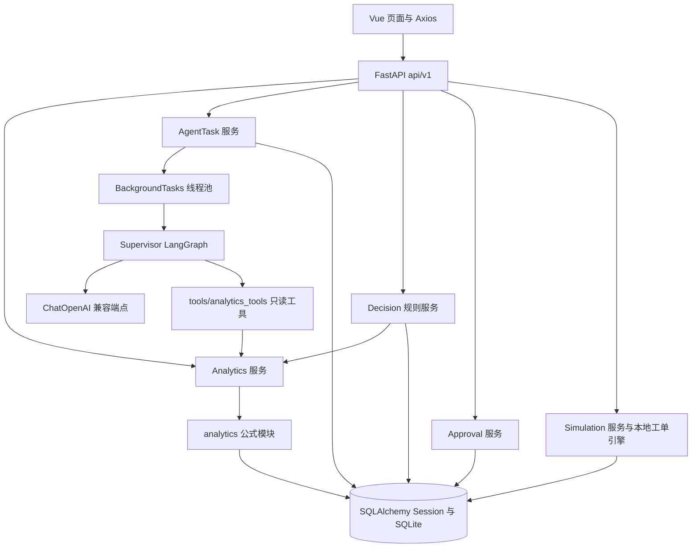
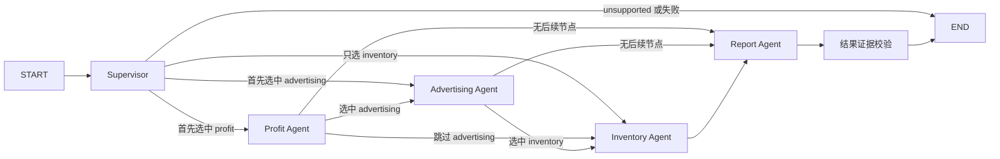
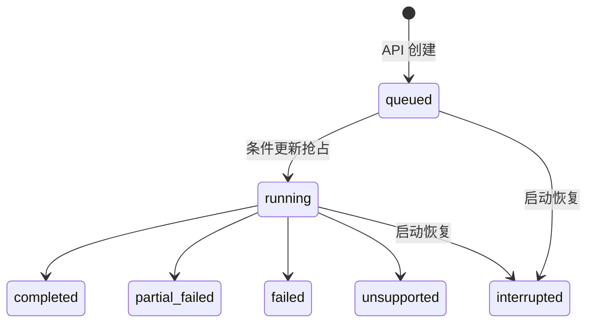
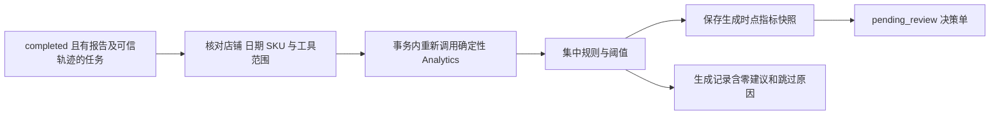
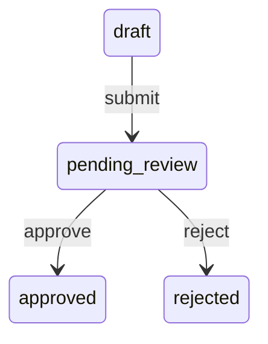
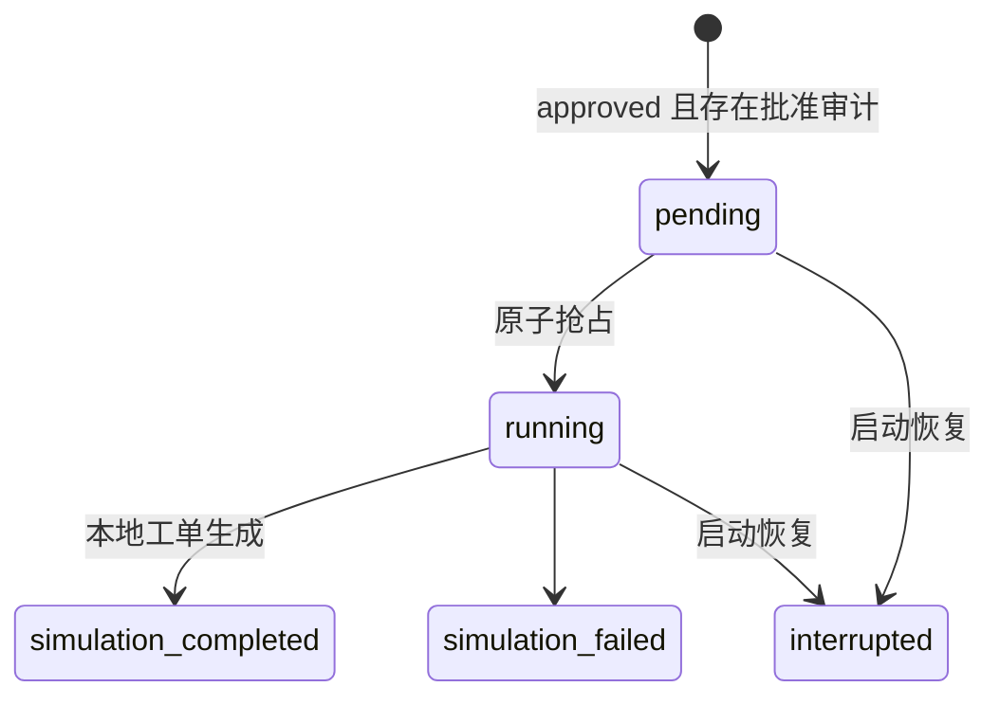
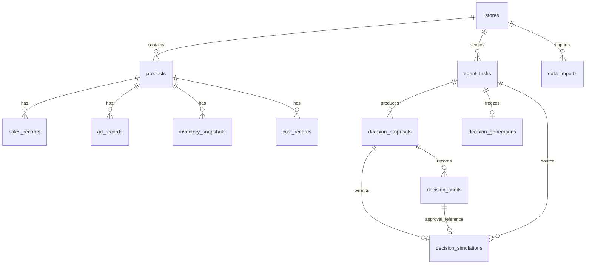

# 系统架构

生产 Supervisor 当前仍使用内嵌 Baseline；eval/safety.py 的 PromptVariant 只在评测时替换 Supervisor 系统消息，保留 JSON Schema 和专业 Agent 消息。Candidate 尚未接入生产。FakeLLM 返回预设路由，只验证流程契约；真实 DeepSeek 才涉及语言路由效果，两者不可等同。审批及模拟是独立人工 API 流程，Agent 图只有只读分析工具。发布审查见 [最终交付报告](FINAL_DELIVERY_REPORT.md)。

这是一个同仓库、单后端进程的本地演示系统。模块之间是Python函数调用；没有Redis、消息队列或其他微服务。前端开发时使用Vite代理，容器设计使用Nginx同源代理（容器运行尚未验证）。

## 分层

`app/main.py`只组装应用和启动恢复；`api/v1`负责参数/响应；`services`负责事务与流程；`analytics`负责确定性分析；`agents`负责路由与证据报告；`models/schemas`分别定义持久化和输入输出。

## LangGraph Supervisor

图中专业节点表示顺序：实际条件边只进入已选节点，未选专业节点不会执行。Supervisor只返回 `intent/selected_agents/reason/confidence`；不能覆盖可信店铺、日期、SKU。最多三个Agent、无回边。6A的显式工具基础图仍独立保留：START→execute_tools→summarize→END。

| 节点 | 职责与权限 |
|---|---|
| Profit Agent | 仅调用 analyze_profit，解释净收入、历史成本、贡献利润及成本变化 |
| Advertising Agent | 仅调用 analyze_advertising，选择 ACOS/ROAS/CPC/转化率证据；不提供 CTR |
| Inventory Agent | 仅调用 analyze_inventory，保留快照、在途与缺失历史语义，不编造需求 |
| Report Agent | 只选择专业Agent已验证证据ID；不能提供自由数值或经营执行动作 |

所有数字由确定性工具计算，专业节点把结果转为Evidence，绑定SKU、字段路径、单位与原值。LLM只选择引用；程序填中文模板并重新渲染比对。null保留为不可计算。报告建议措辞受控，是辅助决策，不是自由推理收益承诺。

## AgentTask 状态

请求Session与后台Session分离，抢占后提交事务，再执行图；模型网络等待期间不持有任务更新事务。保存类型化Report、TaskTrace和错误码，不保存完整工具结果或凭证。进程恢复没有可靠队列，不自动重放；多实例启动可能互相打断，所以仅支持单worker。LLM有单次超时和有限SDK重试，没有全任务硬超时。

## 建议与审批

不能从报告自由文本抽取数字。DecisionGeneration冻结首次生成结果，唯一键避免重复建议；证据是生成时点复算，不冒充原任务快照。成本变化通过历史版本及前后期利润率比较，不能证明唯一因果。

生成器初始状态就是pending_review，无需额外提交。状态条件更新与DecisionAudit同事务提交；终态禁止重复审批。审批身份后端固定 `local-demo-reviewer/local_demo`，不是登录认证。审计无修改/删除API，SQLite触发器阻止普通SQL改删，但不抵御数据库管理员。

## 本地模拟

一条决策最多一条模拟；输入冻结Proposal和批准Audit。Simulation Engine只创建五种工单/评估草案，输出simulation_only=true。短计算在同步API线程执行，不调用LLM，不更新批准状态或经营表。模拟成功不代表利润/广告/库存改善。

## 主要实体关系

业务事实通过(store_id,sku)复合外键关联商品；SKU仅店铺内唯一。决策的(source_task_id,store_id)复合外键、审批和模拟的(proposal_id,store_id)约束防止归属混用；任务/审批ID也保存在模拟快照中。真实用户权限验证尚不存在。

迁移顺序：业务初始化→AgentTask→DecisionProposal/Generation→审批CHECK及Audit→Simulation。显式增量迁移、CHECK升级事务复制，不用create_all升级已有业务结构。详见[数据库](database.md)、[审批](decision_approvals.md)、[模拟](decision_simulations.md)。

## 部署限制

SQLite单写锁、Numeric底层精度限制、无生产认证、单进程BackgroundTasks。Docker设计仅两服务、named volume，宿主机仅127.0.0.1发布前端；实际容器、Python3.11和卷持久化仍待验证。详见[已知限制](known_limitations.md)。
